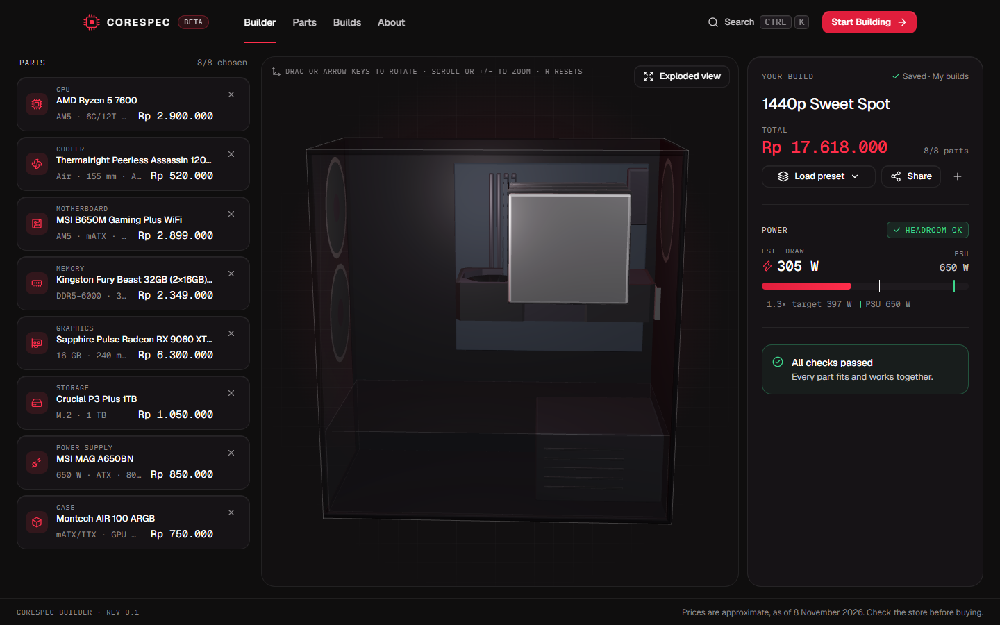
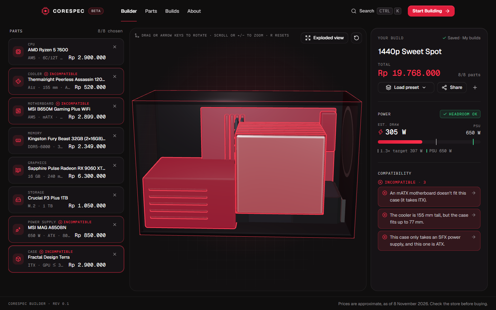
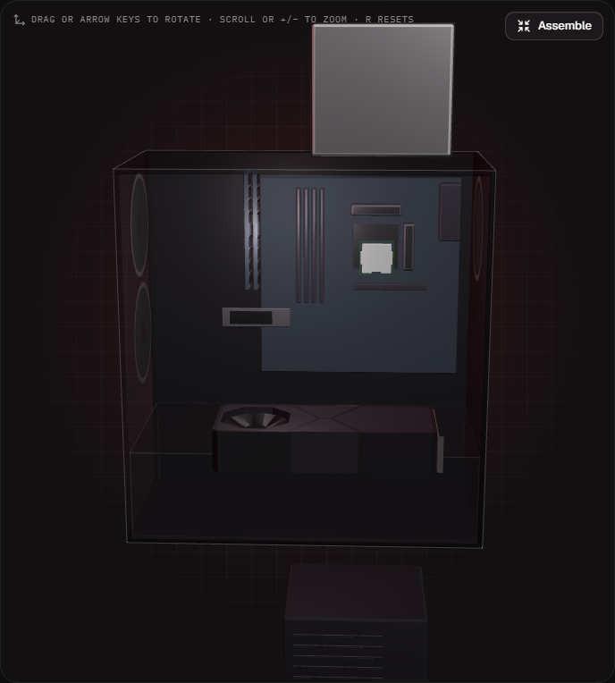
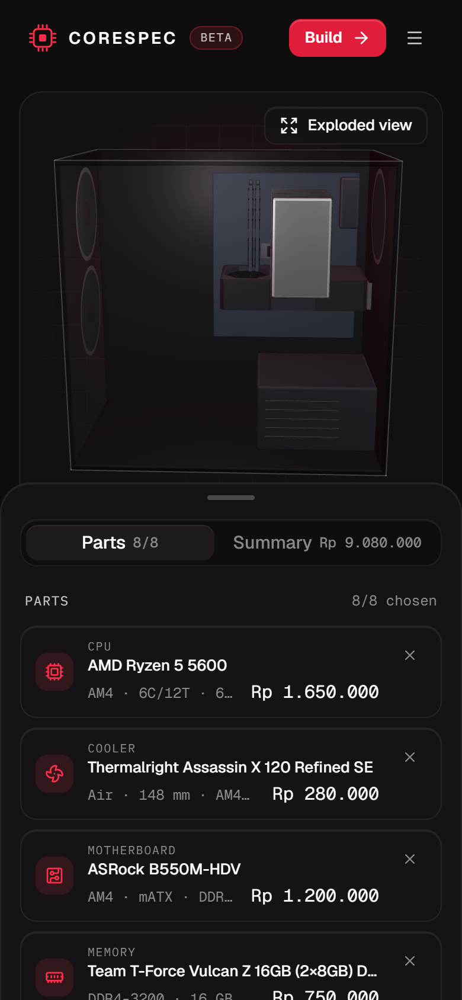
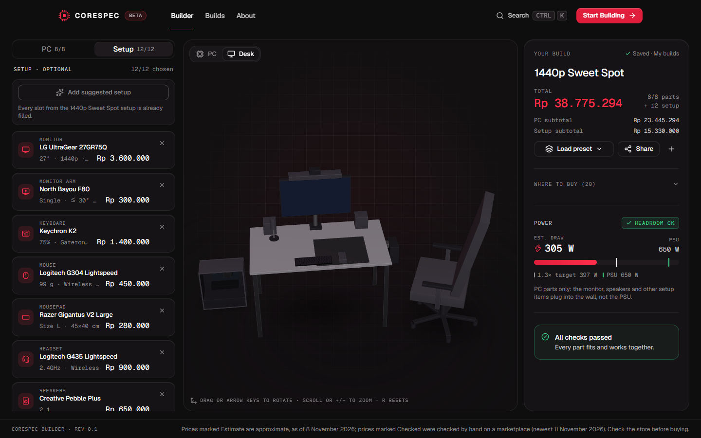
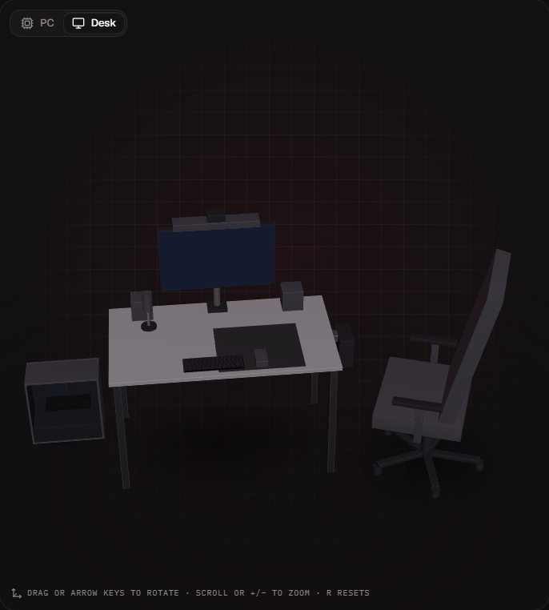

# CoreSpec

**Build your PC in 3D.** A spec-sheet styled PC builder for Indonesian buyers: pick
parts, watch them snap into a 3D case, catch compatibility problems before you pay,
and see every price in Rupiah.



## Features

- **3D builder.** Parts drop into a case sized from real dimensions. Exploded view,
  hover tooltips, orbit with mouse, touch or keyboard.
- **Live compatibility checks.** Socket, memory type, RAM slots, board and case form
  factor, GPU length, cooler height, PSU size and power headroom. Problem parts glow
  coral in 3D and are flagged in the part picker.
- **Desk setup in 3D.** Monitor, arm, keyboard, mouse, chair, desk and 6 more
  categories, placed on a to-scale desk with its own checks (desk width, monitor
  vs graphics card, arm limits, adaptive sync).
- **Prices in Rupiah.** Each price is marked _Checked_ (a marketplace listing
  checked by hand, with its date) or _Estimate_, and links to Tokopedia or
  Shopee. Every category has Budget, Mid and High-end options.
- **Wattage estimate** with a 1.3× PSU headroom target.
- **My builds.** Saved automatically in the browser; rename, duplicate, delete.
- **Share links.** The whole build lives in the URL (`/b/<code>`), with a read-only
  page, "Copy to my builds" and a social preview image.
- **Optional accounts (Phase 16).** With Supabase set up: log in, keep builds in
  your account across browsers, and an admin panel for users, the catalogue,
  checked listings and an audit log. Without it the site works exactly as a
  guest-only app. See [docs/accounts.md](docs/accounts.md).
- **Accessible.** Keyboard-only flow, screen-reader descriptions, zero axe-core
  violations at the last audit.

| Compatibility catch                                                     | Exploded view                                      | Mobile                                             |
| ----------------------------------------------------------------------- | -------------------------------------------------- | -------------------------------------------------- |
|  |  |  |

| Setup tab                                                           | Desk view                                      |
| ------------------------------------------------------------------- | ---------------------------------------------- |
|  |  |

More: [landing page](docs/screenshots/landing.png) · [shared build](docs/screenshots/shared.png) · [5-minute demo script](docs/demo-script.md)

## Tech stack

Next.js 16 (App Router, Cache Components) · React 19 · TypeScript (strict) ·
Tailwind CSS 4 · shadcn/ui on Radix · three.js with React Three Fiber and drei ·
Zustand · Motion · Vitest · Playwright · Supabase (optional: Auth and Postgres
with Row Level Security) · Vercel Analytics · Sentry (optional).

## Getting started

Requirements: **Node.js 20.9 or newer** (24 recommended, see `.nvmrc`) and npm.

```bash
npm install
npm run dev
```

Open <http://localhost:3000>. No environment variables or API keys are needed.

### Scripts

| Command                          | What it does                                                   |
| -------------------------------- | -------------------------------------------------------------- |
| `npm run dev`                    | Development server with hot reload                             |
| `npm run build`                  | Production build                                               |
| `npm start`                      | Serve the production build                                     |
| `npm test`                       | Unit tests (Vitest)                                            |
| `npm run test:e2e`               | End-to-end, keyboard and axe tests (Playwright, see below)     |
| `npm run lint`                   | ESLint                                                         |
| `npm run format`                 | Format everything with Prettier (`format:check` to only check) |
| `npm run models`                 | Build `data/models.json` into `public/models/` (see 3D models) |
| `npm run models:check -- <file>` | Size, triangles, materials and budget of a source model        |
| `npm run hero:poster`            | Re-render the landing hero's poster (server running on :3124)  |
| `npm run db:seed-sql`            | Regenerate `supabase/seed.sql` from the JSON catalogue         |
| `npm run db:export`              | Copy the catalogue from Supabase back into `data/`             |
| `npm run diagrams`               | Redraw the ERD, use case and activity diagrams in `docs/`      |

Before committing: `npm run build && npm run lint && npm test`.

### End-to-end tests

`npm run test:e2e` builds the app, serves it on port 3124 and runs `tests/e2e/` in
your installed Google Chrome: the builder flow, presets, sharing, My builds,
keyboard-only use and an axe-core audit of every page. If a server is already
running on 3124 it is reused. To use Playwright's own Chromium instead, run
`npx playwright install chromium` and set `PLAYWRIGHT_CHANNEL=chromium`.
The suite always runs with accounts off; `E2E_SUPABASE_URL=http://127.0.0.1:9`
runs it with accounts on and the database unreachable (the JSON fallback).

## Project structure

```
app/                  Routes: / · /builder · /builds · /b/[code] · /privacy · /credits · /prices
                      With accounts: /login · /register · /account · /admin (users, items, settings)
components/
  builder/            Slot list, part picker, summary, compatibility panel, viewport
  builds/             My builds library, share dialog
  viewer/             The 3D scene: case shell, parts, models, camera, animation
  landing/ layout/    Landing sections, navbar, footer, command palette
  ui/                 Design-system components (Button, Card, Badge, Dialog…)
  account/ admin/     Login forms, account menu, build sync; admin forms
data/
  parts/*.json        The parts catalogue (73 parts across 8 categories, each tiered)
  presets.json        Starter builds
  meta.json           pricesAsOf date
  credits.json        3D model credits (required for every model)
lib/                  All logic: compatibility rules, power, share codes, 3D layout
  auth/ account/      Sessions (one place: dal.ts), account Server Actions, build merge
  catalogue/          Catalogue fields, listing rules, database rows ↔ items, JSON fallback
supabase/             SQL migrations, seed.sql and the RLS checks (rls.sql)
docs/diagrams, pi/    ERD and use case diagram; the PI diagrams (Indonesian)
proxy.ts              Session refresh, only on the account routes
store/                Zustand stores (builds library, UI state)
models-src/           Original 3D model files, before compression
public/models, draco  Compressed models and the self-hosted Draco decoder
```

Logic lives in `lib/` and is unit-tested; components stay small.

## Updating prices and parts

With accounts on, admins edit items, listings and "estimates as of" in
**Admin → Catalogue** instead, and `npm run db:export` copies those edits back
into the JSON. Without accounts:

1. Edit the part in `data/parts/<category>.json`. Prices are **integer Rupiah**.
2. Set `pricesAsOf` in `data/meta.json` to today's date. It appears in the builder
   footer and on the price disclaimer.
3. Run `npm test`. The data tests check every part, and the presets must stay fully
   compatible. Then run `npm run db:seed-sql` so `supabase/seed.sql` matches.

Each part needs `dims` (mm) so it can be drawn in 3D.

## 3D models

Most parts are drawn procedurally. The CPU, RAM, GPU and keyboards use small open-licence
models. Models are data, not code: each one is an entry in `data/models.json`
(with its credit in `data/credits.json`), and an item can pick its own with
`modelId`. **How to add one, step by step: [`docs/models.md`](docs/models.md).**

`npm run models` builds them into `public/models/` and refuses a missing credit, a
licence that isn't allowed, or a file over 400 KB; the tests check the same rules.
Credits are shown on `/credits`.

## Environment variables

None are required. Optional ones are listed, empty, in [`.env.example`](.env.example):

| Variable                       | Secret? | Purpose                                                   |
| ------------------------------ | ------- | --------------------------------------------------------- |
| `NEXT_PUBLIC_SENTRY_DSN`       | No      | Turns on error reporting. Without it Sentry isn't loaded. |
| `SENTRY_AUTH_TOKEN`            | **Yes** | Uploads source maps at build time. Vercel only.           |
| `SENTRY_ORG`, `SENTRY_PROJECT` | No      | Which Sentry project receives the source maps.            |

Real values go in `.env.local` (git-ignored) or Vercel's environment variables, never
in the repo.

## Launch checklist (Vercel)

1. **Import the repo.** In Vercel: _Add New → Project_, pick the GitHub repo, keep the
   detected Next.js settings, and click _Deploy_. Every push to `main` now deploys
   production; other branches get preview URLs.
2. **Turn on analytics.** Project → _Analytics_ tab → _Enable_. The app already
   includes the script (it only loads on Vercel).
3. **Optional, error reporting.** Create a Sentry project (platform: Next.js). Then in
   Vercel → _Settings → Environment Variables_ add `NEXT_PUBLIC_SENTRY_DSN`, and for
   readable stack traces `SENTRY_AUTH_TOKEN`, `SENTRY_ORG` and `SENTRY_PROJECT`.
   Redeploy. The Privacy page switches its wording automatically.
4. **Set a contact address.** Fill in `CONTACT_EMAIL` in `lib/site.ts`; the Privacy
   page shows it.
5. **Optional, accounts.** Follow [docs/accounts.md](docs/accounts.md): create
   the Supabase project, run the SQL in `supabase/`, and set
   `NEXT_PUBLIC_SUPABASE_URL` and `NEXT_PUBLIC_SUPABASE_PUBLISHABLE_KEY` (type
   Config). No secret key is needed.
6. **Later, a custom domain.** Project → _Settings → Domains_ → add it, then create
   the DNS record Vercel shows at your registrar. Absolute URLs (sitemap, share
   previews) follow the production domain automatically.
7. **Smoke test.** Open the production URL: load a preset, share a build and open the
   link in a private window, then check `/sitemap.xml` and `/robots.txt`.

## Legal

- [Privacy](app/privacy/page.tsx): without accounts, no cookies and builds stay in
  the browser; with accounts on, it also explains what an account stores
  (email, display name, builds, in Supabase, Singapore) and how to delete it.
- [Price disclaimer](app/prices/page.tsx): prices are estimates, so check the store
  before buying.
- [Credits](app/credits/page.tsx): 3D models, open-source software and fonts.

CoreSpec isn't affiliated with any shop or manufacturer; product names belong to
their owners.
