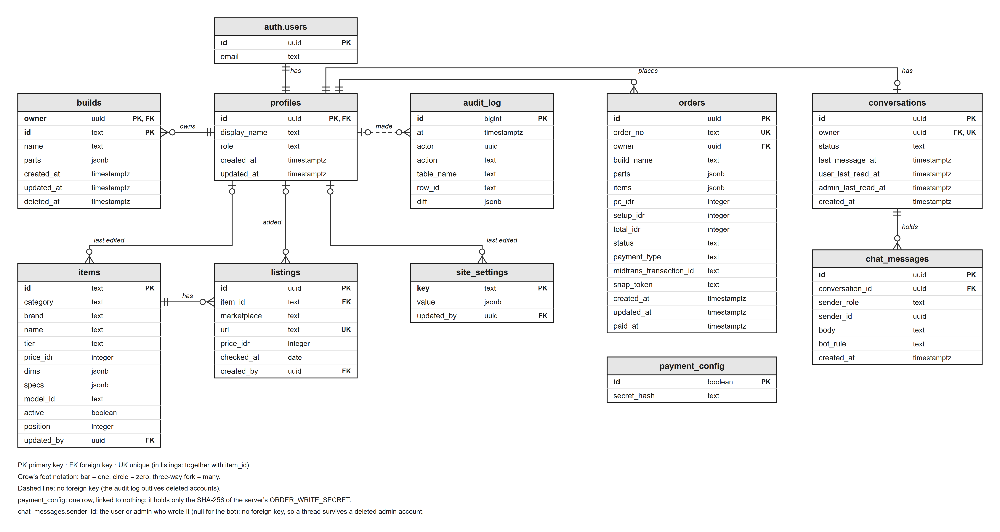

# Accounts (Phase 16)

Optional logins on top of CoreSpec, using Supabase (Auth and Postgres). Without
the Supabase settings the site has no login at all and works exactly as before.

- **Status:** 16a is built and set up on the real Supabase project (all checks
  in `rls.sql` pass there): accounts, builds in the account, guest import, roles
  and the admin users page. 16b (built, not yet run on the real project) moves
  the catalogue and listings into the database, with admin editing and an audit
  log; see "The catalogue in the database" below. 16c added the diagrams and
  finished these docs.
- **The plan:** [`phase-16-plan.md`](phase-16-plan.md).
- **Diagrams:** [ERD](diagrams/erd.svg) and [use cases](diagrams/use-cases.svg)
  (English); the PI versions in Indonesian, with four activity diagrams and the
  numbers, are in [`pi/`](pi/angka.md). Redraw them all with
  `npm run diagrams` (`scripts/diagrams.mjs`).

## Who can do what (Row Level Security)

| Table           | Read                                | Write                                                                                                         |
| --------------- | ----------------------------------- | ------------------------------------------------------------------------------------------------------------- |
| `profiles`      | your own; admins read all           | your own `display_name` only. `role` only through `set_role()` (admins, never your own, never the last admin) |
| `builds`        | your own only (admins can't either) | your own; no deletes: deleting sets `deleted_at` (a tombstone)                                                |
| `items`         | everyone, active and inactive       | admins                                                                                                        |
| `listings`      | everyone                            | admins, within the listing rules (database checks)                                                            |
| `site_settings` | everyone                            | admins                                                                                                        |
| `audit_log`     | admins                              | nobody: only the trigger writes                                                                               |

`supabase/tests/rls.sql` checks every row of this table as anon, as a user and
as an admin.



## How it fits together

- **No Supabase code in the browser**, with one exception (the chat's
  Realtime listener, below). Logging in, logging out and syncing are Server
  Actions. The session lives in httpOnly cookies that page scripts can't read.
- **Every query runs as the visitor**, so the database's Row Level Security
  decides what they can see and change. The app has no service-role key at all.
- **Who is logged in** is decided in one place: `lib/auth/dal.ts`. Every
  protected page and every Server Action asks it again. `/admin` is a 404 for
  anyone who isn't an admin.
- **`proxy.ts`** (Next 16's name for Middleware) only runs on `/account`,
  `/admin`, `/login`, `/register`, `/forgot-password` and `/auth/*`. It renews the
  session cookie. The landing page, builder, My builds and shared builds never
  touch it, so they stay static.
- **The navbar menu** reads a small non-secret cookie, `cs-auth` (`user` or
  `admin`), so it can show "Account" without a server request. The cookie grants
  nothing.
- **Builds:** the browser's store (`store/build.ts`) stays the working copy.
  - Builds made while logged in get the account as their `owner`.
    `components/account/account-sync.tsx` sends changes about a second after
    each edit. The newest edit wins, and a delete always wins.
  - Deleting leaves a tombstone (`builds.deleted_at`), so a stale copy in
    another browser can't upload it again. The rules are in
    `lib/account/merge.ts`, with unit tests.
  - Guest builds (made before logging in) stay in the browser until you import
    them. The prompt comes once after login and the button stays on My account.
  - Logging out removes the account's builds from that browser; guest builds
    stay.
- **An expired access token** during a sync from `/builder`, where Proxy
  doesn't run, is renewed inside the Server Action. If renewal fails, the
  browser retries once (two tabs may have renewed it at the same moment), then
  shows "Please log in again". Builds stay safe in the browser meanwhile. See
  `lib/account/sync.test.ts`.

## Environment variables (names only)

| Name                                   | Where                            | Notes                                                                                           |
| -------------------------------------- | -------------------------------- | ----------------------------------------------------------------------------------------------- |
| `NEXT_PUBLIC_SUPABASE_URL`             | `.env.local`, Vercel **Preview** | Project Settings → API                                                                          |
| `NEXT_PUBLIC_SUPABASE_PUBLISHABLE_KEY` | `.env.local`, Vercel **Preview** | Project Settings → API Keys → publishable (`sb_publishable_…`). The legacy anon key also works. |
| `NEXT_PUBLIC_AUTH_EMAIL`               | optional                         | `on` once a real email sender is set up. Shows "Forgot password?".                              |

Set these for **Preview** only. Production (the demo on `main`) then stays
exactly as it is, even after a merge, until they are added to Production too.
Never add a service-role or secret key: nothing uses one.

## Setting up the project (Rei, in the Supabase dashboard)

1. **New project.** Region: **Southeast Asia (Singapore)**, the closest to
   Indonesia.
2. **Turn on email logins.** Go to **Authentication → Sign In / Providers →
   Email**:
   - **Enable email provider:** on. A new project can have it **off** by
     default, and then nobody can register or log in.
   - **Confirm email:** off. (See "Email confirmation" below for why.)
   - **Minimum password length:** 8, the same as the app's own check
     (`lib/auth/validate.ts`).

   Save.

3. **Set the URLs.** In **Authentication → URL Configuration**:
   - **Site URL:** your preview URL.
   - **Redirect URLs:** add `http://localhost:3000/**` and
     `https://*-YOUR-SCOPE.vercel.app/**`.

   **Finding YOUR-SCOPE:** it's your Vercel account or team slug, and every
   preview URL ends with it, just before `.vercel.app`. For example, in
   `corespec-git-feat-phase-16-auth-rc-d1d8.vercel.app` the scope is `rc-d1d8`,
   so the redirect URL is `https://*-rc-d1d8.vercel.app/**`. It's also the
   first part of the dashboard address, `vercel.com/YOUR-SCOPE/…`. It isn't the
   GitHub account name.

4. **Create the tables.** Open **SQL Editor → New query**. Paste each file in
   `supabase/migrations/`, in name order, and **Run** each one:
   1. `20261112000100_profiles.sql`
   2. `20261112000200_builds.sql`
   3. `20261112000300_account_admin.sql`

   They are safe to run again.

5. **Check the security rules.** Paste `supabase/tests/rls.sql` into a new query
   and **Run**.
   - **Pass:** the result is **All RLS tests passed**. It rolls everything back,
     so it leaves no test users behind.
   - **Fail:** it stops at the first problem and names it.
6. **Put the two env vars** in `.env.local` and in Vercel → Settings →
   Environment Variables:
   - **Environment:** **Preview** only.
   - **Type:** **Config**. Vercel refuses the **Secret** type for
     `NEXT_PUBLIC_` variables, because those are built into the page anyway.
     That's fine here: the URL and the publishable key are meant to be public,
     and RLS protects the data.

   Then redeploy the preview: push, or Vercel → Deployments → Redeploy. Vercel
   may ask you to confirm the redeploy with a code sent to your email.

7. **Create your account.** Register at `/register` on the preview.
8. **Make yourself admin.** In **SQL Editor**, run this with your own email:

   ```sql
   update public.profiles set role = 'admin'
   where id = (select id from auth.users where email = 'YOUR-EMAIL');
   ```

   It works here because the SQL editor runs as the database owner. Nobody can
   do this from the website: users can't write `role`, and
   `public.set_role()` only accepts admins.

9. **Check it.** Log out and log in again. The account menu now has **Admin**,
   and `/admin` opens. From now on, promote others in **Admin → Users**.

## The catalogue in the database (16b)

### How it works

- **The JSON in `data/` stays the base.** It's bundled into the site, so the
  builder works with no database at all. The database holds the same catalogue
  (`items`, `listings`, `site_settings`), and admins edit it there.
- **Pages get only the differences.** `lib/catalogue/load.ts` reads the
  database (cached, tag `catalogue`) and compares it with the JSON
  (`lib/catalogue/rows.ts`). Only the items that differ go to the page, so a
  database that matches the JSON adds nothing at all to any page.
  `lib/parts.ts` applies those differences in place, on the server and in the
  browser (handed over by `components/catalogue/catalogue-overlay.tsx` in the
  root layout).
- **Pages stay static.** The landing page, builder and shared builds are built
  with the cached catalogue. An admin save calls `updateTag("catalogue")`, so
  they're rebuilt in the background within seconds; otherwise at the latest
  every hour.
- **The fallback.** With no Supabase settings, or settings but a database that
  can't be reached within 4 seconds, or one where `seed.sql` hasn't run yet, the
  site shows the JSON exactly as before and tries again within a minute. The
  admin overview says so. Tested in `lib/catalogue/catalogue.test.ts` (off,
  connection refused, no answer, empty, seeded, one edit) and by running the
  whole e2e suite with an unreachable database (below).
- **Deactivated items** (`active = false`) leave the builder's picker only.
  Everyone can still read them, so saved builds and share links that use them
  keep working. Items a preset uses can't be deactivated.
- **Listing rules** are the same as `npm run prices:apply`, checked in the admin
  form and again by the database (`listings` checks): https, on the
  marketplace's own domain, a whole number of rupiah above 0, a check date not
  in the future (Indonesian time). The "more than 40% from the estimate" check
  stays a question in the admin form: tick "The price is right" to save anyway.
- **The audit log** (`audit_log`) records every change to items, listings,
  settings and roles: who, when, and which fields changed. Only admins can read
  it; nobody can edit it.

### Setting it up (after the 16a steps)

In **SQL Editor → New query**, paste each file and **Run**, in this order:

1. `supabase/migrations/20261112000400_catalogue.sql`
2. `supabase/migrations/20261112000500_audit.sql`
3. `supabase/seed.sql`: the catalogue from the JSON. The result says **Seeded
   181 items and 4 listings**.
4. `supabase/tests/rls.sql` again: it now checks items, listings, settings and
   the audit log too. The result says **All RLS tests passed**. It works on a
   project in use: it only counts its own test accounts or compares with what
   was there before, and rolls everything back. With other admins present, the
   "last admin can't delete their account" check is skipped with a notice.

Later, for **Delete item** on `/admin/items/<id>` (November 2026):
`supabase/migrations/20261115000100_item_delete.sql`, then `rls.sql` once more.
Until it has run, the item page says it can't check usage and offers no delete.

All four are safe to run again. **Careful:** running `seed.sql` again puts the
seeded items back as the JSON has them, undoing admin edits to them. Run
`npm run db:export` first if those edits should be kept.

### Admin pages

- **`/admin/items`:** every item, with search and filters (category, tier,
  active or not, no checked listing). **Add item** creates a new one.
- **`/admin/items/<id>`:** the item's fields (the spec inputs come from
  `lib/catalogue/schema.ts`) and its checked listings: add, edit, delete, and
  **Mark checked today**. **Delete item** removes an item for good, with its
  listings, after you type its id. Only for items you added (not from the
  repo's JSON, which would bring them back), that no preset uses and that no
  saved build uses (`item_usage_count`, a count only); otherwise the page says
  why and you deactivate it instead. The audit log keeps the deleted rows.
  Share links that held the item open without it, with a note.
- **`/admin/settings`:** "Estimates as of".
- **`/admin`:** catalogue totals, listings over 14 days old, and the 12 most
  recent changes from the audit log.

### Keeping the JSON in step

`npm run db:export` copies the database's catalogue back into `data/` (the JSON
files, `meta.json` and `price-check.csv`), using the publishable key from
`.env.local`. Look at `git diff`, run `npm test`, commit. `-- --check` only
reports what would change. A database seeded from the JSON exports back to the
same files byte for byte (`scripts/db-export.test.ts`).

After changing the JSON by hand (or with `prices:apply`), run
`npm run db:seed-sql` to regenerate `supabase/seed.sql`; the unit tests fail
while it's out of date.

## Email confirmation

**Off for now.**

- **Why:** Supabase's built-in email sender only delivers to members of your
  Supabase organisation, a few emails an hour. With confirmation on, your
  supervisor couldn't register with their own address.
- **Both paths are built.** With confirmation on, `/register` says "Check your
  email", and the link finishes sign-up through `/auth/confirm`.

To turn it on later:

1. **Set up a sender.** Supabase → **Authentication → Emails → SMTP Settings**:
   a custom SMTP sender (e.g. Resend).
2. **Point the email templates at `/auth/confirm`.** In **Authentication →
   Emails → Templates**:
   - **Confirm signup:**
     `{{ .SiteURL }}/auth/confirm?token_hash={{ .TokenHash }}&type=email&next=/account`
   - **Reset password:**
     `{{ .SiteURL }}/auth/confirm?token_hash={{ .TokenHash }}&type=recovery&next=/account/password`
3. **Switch on "Confirm email"** (step 2 of the setup above).
4. **Set `NEXT_PUBLIC_AUTH_EMAIL=on`**, which also shows "Forgot password?".

## Checkout simulation (Phase 17a)

A **payment simulation** with Midtrans's **Sandbox**: no real money moves,
nothing is sold, stocked or shipped, and every checkout and order screen says
so. Only the sandbox hosts are in the code (`app.sandbox.midtrans.com`,
`api.sandbox.midtrans.com`), so even a production key couldn't charge anyone.

### How it works

1. The builder's **Checkout (simulation)** button is disabled while the build is
   empty or has compatibility **errors** (warnings are fine). Guests log in
   first.
2. `/checkout` shows the order. **Pay with Midtrans (sandbox)** calls
   `startCheckout`: the server reprices every item from the catalogue (prices
   never come from the browser), creates the order with `create_order`, asks
   Snap for a token (60-minute expiry; the buyer's **display name only**, never
   the email) and stores it. Only then does the browser load `snap.js` and open
   the pop-up.
3. `/orders/<id>` asks Midtrans for the status once on load (`refreshOrder`),
   and has **Check payment status** and **Continue payment**. This is the main
   path: it works on localhost and previews.
4. The **notification URL** `/api/midtrans/notification` checks the signature,
   the amount, then confirms with the status API. A Vercel preview is behind
   Vercel's login, so Midtrans can only reach it on production.

**Trusted writes without a service-role key.** Nobody can insert, update or
delete orders directly. The server writes them through `create_order` and
`set_order_payment` (`security definer`), which refuse every call unless the
caller passes `ORDER_WRITE_SECRET`. The database keeps only the secret's
SHA-256 in `payment_config` (no grants, no policies), and refuses everything
while that hash is empty. `set_order_payment` holds the status rules: `paid` is
final, `pending` never replaces another status, `paid_at` is set once. A
spam cap allows 5 pending orders per account per hour.

### Environment variables (names only)

| Name                              | Kind                                  | Where                                                 |
| --------------------------------- | ------------------------------------- | ----------------------------------------------------- |
| `MIDTRANS_SERVER_KEY`             | **secret**, server only (type Secret) | Midtrans dashboard (sandbox) → Settings → Access Keys |
| `NEXT_PUBLIC_MIDTRANS_CLIENT_KEY` | public by design (type Config)        | Same page, Client Key                                 |
| `ORDER_WRITE_SECRET`              | **secret**, server only (type Secret) | Made locally, below. 32 random bytes.                 |

All three, plus the two Supabase settings, or checkout stays off.

### Setting it up

**Status (17 Nov 2026):** steps 1–4 are done for the Supabase project and the
Vercel **Preview** environment. The migration ran, `rls.sql` passed, the hash
is stored, the three variables are set, and a sandbox card payment went through
on the preview (two orders **Paid**). Production has no Midtrans variables, so
checkout is off there. Step 5 waits until it's turned on.

1. **Migration:** run `supabase/migrations/20261117000100_orders.sql` in the
   SQL editor, then rerun `supabase/tests/rls.sql` (it must end with "All RLS
   tests passed").
2. **The secret and its hash**, in the repo folder on your laptop. This adds
   the secret to `.env.local` without printing it, and prints only its SHA-256:

   ```sh
   node -e "const c=require('crypto');const s=c.randomBytes(32).toString('base64url');require('fs').appendFileSync('.env.local','\nORDER_WRITE_SECRET='+s+'\n');console.log(c.createHash('sha256').update(s,'utf8').digest('hex'))"
   ```

   The printed hash (64 hex characters) is safe to share; the secret is not.

3. **Store the hash** (SQL editor), with the printed value:

   ```sql
   update public.payment_config set secret_hash = '<the 64-character hash>' where id;
   ```

4. **Vercel → Settings → Environment Variables**, environment **Preview**:
   `MIDTRANS_SERVER_KEY` and `ORDER_WRITE_SECRET` as **Secret** (copy the
   secret from `.env.local`), `NEXT_PUBLIC_MIDTRANS_CLIENT_KEY` as **Config**.
   Then redeploy the preview (the checkout switch is read at build time).
5. **Production only, later:** Midtrans dashboard → Settings → Configuration →
   Payment Notification URL = `https://corespec-eight.vercel.app/api/midtrans/notification`.

To turn it off again, remove any one of the three variables and redeploy. To
lock the database side at once: `update public.payment_config set secret_hash = null where id;`.

### Checking a payment by hand (it can't run in CI)

- [ ] Builder, empty build: the button is disabled, "Add a part to check out."
- [ ] Two incompatible parts: "Fix 1 compatibility error to check out."
- [ ] Logged out, Budget 1080p: Checkout goes to the login page, then `/checkout`.
- [ ] `/checkout` shows the banner, "SIMULASI — bukan bukti transaksi", the
      items with Checked/Estimate, both subtotals and the total.
- [ ] Pay → the Snap pop-up opens. Card `4811 1111 1111 1114`, any future
      expiry, CVV `123`, OTP `112233` → the order page shows **Paid**, the
      method and the Midtrans transaction id.
- [ ] Another order, close the pop-up before choosing a method → the order
      page says **Pending**; "Check payment status" keeps it pending (Midtrans
      has no transaction yet: a 404, handled).
- [ ] "Continue payment" reopens the same payment; pay with QRIS (copy the QR
      image address into the QRIS simulator) or BCA VA (VA simulator).
- [ ] Note what Snap does with **QRIS above Rp 10.000.000** (the Budget 1080p
      total is Rp 9.080.000; the 1440p preset is above the limit).
- [ ] `/orders` lists both; another account can't open them (404).
- [ ] Admin → Orders lists every order with the account name; the status
      filter works.
- [ ] Six checkouts within an hour without paying: the sixth says "5 unpaid
      orders".
- [ ] **Receipt (17b):** on a paid and on a pending order, **Download receipt
      (PDF)** saves `corespec-receipt-<order_no>.pdf`, with the status, the
      payment method, the PC and desk pictures, the items, "Compatibility
      (checked <today>)", the QR code (scan it: it opens the share page) and
      "SIMULASI — bukan bukti transaksi" on every page.
- [ ] The same from a phone: the pictures look the same as from the laptop.

## Live chat (Phase 18)

A logged-in user chats with the admin; a **rule-based bot** (no AI) answers
common questions first. Chat needs accounts on: without the Supabase settings
there is no chat at all (no button, no Realtime code, no outside request, and
`/admin/chat` is a 404).

### How it works

- **Tables:** `conversations` (one per user, `open` or `closed`, read times
  for the user and the admins) and `chat_messages` (1–1000 characters after
  trimming; `sender_role` user, admin or bot).
- **Reading:** the owner reads their own conversation and messages; admins
  read all.
- **Writing:** users insert their own messages (`sender_role = 'user'`, into
  their own conversation) and admins theirs (`'admin'`, anywhere), through
  insert policies. A trigger sets the time and trimmed text, checks the
  sender again and holds the **rate limit: 5 messages in 30 seconds and 60 a
  day per user** (admins: none). Nobody can edit or delete a message.
- **The bot** writes only through `post_bot_reply()`, which needs
  `ORDER_WRITE_SECRET` (the checkout's secret: no new variable) and only
  answers when the latest message is the user's. Without the secret the chat
  still works and the admin answers everything.
- **"Needs admin"** isn't stored: a conversation needs the admin when its
  latest bot message used the `human` rule or the fallback and no admin has
  written since (`needsAdmin()` in `lib/chat/bot.ts`).
- **Live updates:** after each insert, a trigger sends the message with
  Realtime Broadcast to the private topics `chat:<conversation id>` and
  `chat:admin`. Select policies on `realtime.messages` decide who may join:
  the owner or an admin for `chat:<id>`, admins only for `chat:admin`
  (`can_join_chat_topic()`). There is no insert policy there: clients only
  listen. If `realtime.send` fails, the message is still saved (a warning is
  logged) and the panel's polling picks it up.

### The panel and the inbox (18b)

- **The chat button** (bottom right) shows for logged-in visitors on every
  page except `/admin/*`, and hides while Midtrans's Snap pop-up is open.
  Guests see nothing; `/about` says "Log in to chat with the admin."
- **The panel** loads with `import()` on the first press: a full-height sheet
  on phones, a 380 × 560 card on larger screens. The last 50 messages ("Load
  earlier" for more), quick-reply chips when the chat is empty or after a bot
  reply, a 1000-character counter, Enter to send and Shift+Enter for a new
  line. It's a dialog: focus goes to the text box, new messages are read out
  by a polite live region, Escape closes it and focus returns to the button.
- **Unread dot:** the button asks the server whether the admin or the bot
  wrote since the user last read the chat, at most once a minute per tab
  (sessionStorage), and once when the panel closes. No background socket.
- **`/admin/chat`** (and a "Chat" card on `/admin` with the number of unread
  conversations): conversations newest first with name, preview, Unread and
  "Needs admin"; filters All / Needs admin / Open / Closed; the thread with a
  reply box and Close / Reopen. On phones the list and the thread take turns.
  The inbox reads at most the 200 newest conversations and their 2,000 newest
  messages, plenty at this scale.

### The Realtime token: the one Supabase exception in the browser

Realtime needs the user's access token in the browser. So far no Supabase
code ran there and the session stayed in httpOnly cookies. Now:

- `getRealtimeToken()` (a Server Action) returns the visitor's current access
  token and its expiry, or null for guests. It goes through `getSession()`,
  which renews the token when it's near expiry.
- The browser loads only `@supabase/realtime-js` (pinned to the version
  `@supabase/supabase-js` uses, so there's one copy), and only when the panel
  or `/admin/chat` opens. It passes the token to Realtime, asks for a new one
  90 seconds before it expires or after a channel error, and **only
  listens**: it never queries the database or sends anything over Realtime.
  Every write is still a Server Action.
- **What changes:** a script on those two screens holds the access token in
  memory while they're open. It's the same token the cookies hold and only
  allows what RLS allows the user anyway, but a script injected into the page
  could read it there, where it couldn't read the httpOnly cookie. It isn't
  stored anywhere (not in localStorage, not in a cookie).
- **Fallback:** if the channel isn't subscribed within 10 seconds, or drops,
  the panel (and the inbox) polls a Server Action every 5 seconds until
  Realtime is back, then polls once more to catch up. The header shows Live
  or Reconnecting.

### Setting it up

**Status (18 Nov 2026):** done on the real Supabase project. The migration ran
and `rls.sql` (191 checks) passed there. The functions run in Vercel's
Singapore region (`sin1`, set in `vercel.json`), next to the database. The
two-browser checklist below passed on the preview (an iPhone and a laptop).

1. **Migration:** run `supabase/migrations/20261118000100_chat.sql` in the SQL
   editor (after the orders migration: it reuses `check_order_secret`), then
   rerun `supabase/tests/rls.sql` (it must end with "All RLS tests passed").
2. Nothing else: no new environment variable.

### Checking Realtime by hand (it can't be tested locally)

The local tests check the join rules through a stand-in for Supabase's
`realtime` schema, not Realtime itself. With two browsers on the preview:

- [ ] User A opens the chat: their messages arrive live in A's panel and in the
      admin's `/admin/chat`, without a refresh.
- [ ] User B, logged in elsewhere, never sees A's messages, and can't join A's
      topic (no messages arrive when subscribing to `chat:<A's id>` by hand).
- [ ] A non-admin can't receive anything on `chat:admin`.

### Checking the chat by hand (two browsers, e.g. a phone and a laptop)

- [ ] **User** (phone): the chat button is there; a guest sees none.
- [ ] Open it: the empty chat shows the quick questions. Tap "Are the prices
      real?": the bot answers at once.
- [ ] **Admin** (laptop, `/admin/chat`): the conversation appears at the top
      without a refresh, header "Live".
- [ ] Type "talk to admin" on the phone: the bot says the admin will reply, and
      the inbox shows "Needs admin".
- [ ] Reply from the inbox: the phone shows it at once, without a refresh; the
      bot skips greetings and "talk to admin" for the next 10 minutes but
      still answers questions (try "bagaimana cara share build?"); "Needs
      admin" goes away.
- [ ] Close the panel, reply again from the admin side, wait a minute and open
      another page: the button shows the unread dot.
- [ ] A second user account never sees the first one's messages.
- [ ] Send 6 messages quickly: the 6th says "You're sending messages too
      fast…".
- [ ] Turn wifi off on the phone for 20 seconds: the header says
      Reconnecting; turn it on: it says Live again, and anything sent
      meanwhile appears.
- [ ] Close and reopen a conversation from the inbox; the user writing again
      reopens it.
- [ ] Keyboard: open the panel, Escape closes it and focus is back on the
      chat button.
- [ ] On `/checkout`, the chat button disappears while the Snap pop-up is
      open.

## Checking the preview by hand

- [ ] **As a guest:** the builder, presets, sharing and My builds all work.
      Nothing about accounts appears except a "Log in" link.
- [ ] **Import:** make a build as a guest, then register. The import prompt
      offers 1 build. Click **Import**. My builds says "In your account".
- [ ] **Sync:** make a build, then open the preview in another browser (or a
      private window) and log in. The build is there.
- [ ] **Delete:** delete it in one browser and reload the other. It's gone
      there too, and it doesn't come back.
- [ ] **Log out:** account builds leave that browser. Guest builds stay.
- [ ] **Admin access:** as a normal user, `/admin` is a 404. As admin,
      **Admin → Users** lists everyone. You can't change your own role.
- [ ] **Delete account:** in My account, **Delete account** removes the
      account. Logging in with it then fails.
- [ ] **Catalogue (16b):** in **Admin → Catalogue**, change an item's
      estimate and save. Within a few seconds a fresh load of the builder shows
      the new price for it. Change it back.
- [ ] **Listing:** add a listing with a price far from the estimate. The form
      asks you to confirm. **Mark checked today** sets today's date.
- [ ] **Deactivate:** untick "In the picker" on an item. The builder's picker
      no longer offers it; a share link that uses it still opens. Tick it again.
- [ ] **Audit:** `/admin` lists those changes under "Recent changes".

## Files

- **Database:** `supabase/migrations/*.sql` (tables, RLS, functions) and
  `supabase/tests/rls.sql` (the RLS checks).
- **Tests run here:** `supabase/rls.test.ts` runs the same migrations and checks
  against a local Postgres (PGlite) in the unit tests, so they're tested without
  a real project.
- **Auth:**
  - `lib/supabase/` (config, the server client);
  - `lib/auth/` (DAL, Server Actions, form checks, the hint cookie);
  - `proxy.ts`.
- **Builds:** `lib/account/` (merge rules, the sync Server Action) and
  `store/build.ts` (`account`, `tombstones`, `owner`).
- **UI:** `components/account/`, `app/login`, `app/register`, `app/account`,
  `app/admin`, `app/auth/confirm`, `app/forgot-password`.
- **Checkout (17a):** `supabase/migrations/20261117000100_orders.sql`,
  `lib/checkout/` (order rules, Midtrans client, Server Actions, the
  notification logic), `app/api/midtrans/notification`, `components/checkout/`,
  `app/checkout`, `app/orders`, `app/admin/orders`.
- **Chat (18a, 18b):** `supabase/migrations/20261118000100_chat.sql`;
  `lib/chat/` (`bot.ts` the rules, `service.ts` / `panel.ts` / `inbox.ts` the
  server steps, `actions.ts` and `admin-actions.ts` the Server Actions,
  `store.ts` Supabase, `live.ts` the Realtime-or-polling rules, `realtime.ts`
  the browser's Realtime client); `components/chat/` (button, panel, inbox,
  styleguide samples); `app/admin/chat`, `app/styleguide/chat`; the Realtime
  stand-in in `supabase/tests/supabase-shim.sql`.
- **Receipt (17b):** `lib/receipt/` (the PDF layout: data in, bytes out, with
  pdf-lib and uqr), `components/receipt/` (the button and the off-screen 3D
  capture), `components/viewer/capture-frame.tsx`.
- **Catalogue (16b):**
  - `lib/catalogue/` (fields per category, listing rules, rows ↔ items, the
    loader and its fallback, the seed generator);
  - `lib/admin/` (catalogue Server Actions and form reading),
    `components/admin/`, `app/admin/items`, `app/admin/settings`;
  - `supabase/seed.sql` (generated) and `supabase/seed.test.ts`;
  - `scripts/db-export.mjs`.
